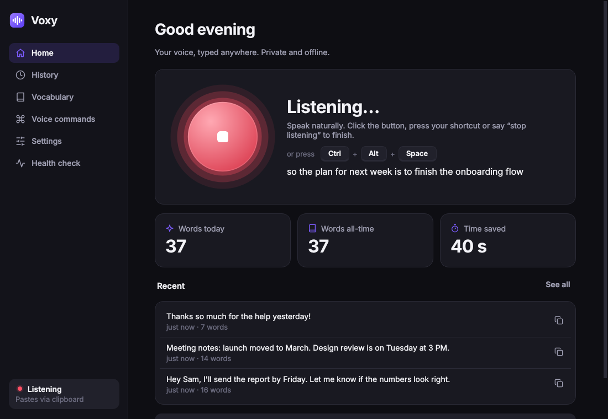
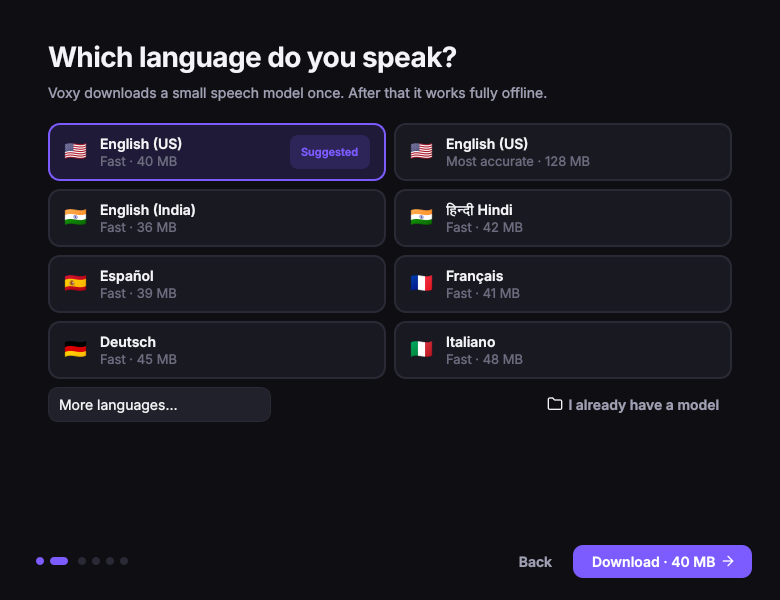
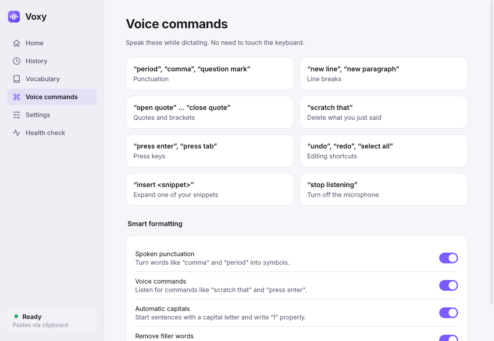
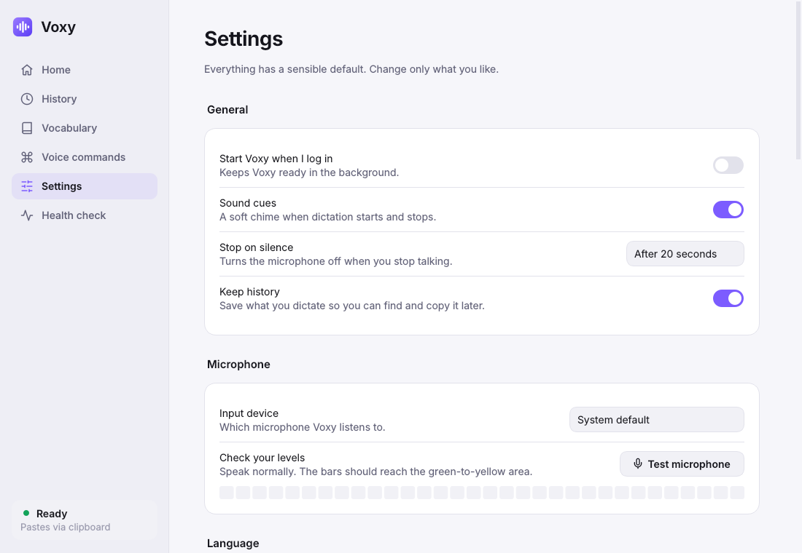

# Voxy

Offline voice typing for Linux. Voxy transcribes speech locally with [Vosk](https://alphacephei.com/vosk/) and types the result into the focused window.


| | |
| --- | --- |
|  |  |
|  |  |

## Install

```bash
git clone https://github.com/arjun-kale/voxy.git
cd voxy
./scripts/install.sh
```

The script installs the system packages (apt, dnf or pacman), creates a virtualenv in `~/.local/share/voxy`, links `voxy` into `~/.local/bin`, adds a desktop entry and starts the app. Use `--no-system` to skip the package step.

On first launch a setup window downloads a speech model, tests the microphone and sets the global shortcut (default <kbd>Ctrl</kbd>+<kbd>Alt</kbd>+<kbd>Space</kbd>). The shortcut is registered automatically on GNOME; on other desktops, bind `voxy toggle` yourself.

## Features

- Tray icon, main window and a floating bar with waveform and live transcript while dictating
- Automatic capitalisation, spoken punctuation ("comma", "period", "new paragraph", quotes, brackets) and filler-word removal
- Voice commands: "scratch that", "press enter", "send it", "press tab", "undo", "redo", "select all", "stop listening"
- Word replacements and snippets ("insert my email")
- Searchable history with copy and re-type
- Stops after a configurable period of silence
- The microphone is only open while dictating
- Typing backend chosen per session (`wtype`, `xdotool`, `ydotool`), with clipboard fallback
- Health check page and `voxy doctor`
- 16 languages; models are downloaded from the app or the CLI

## Usage

```bash
voxy                    # open the app
voxy app --background   # start in the tray
voxy toggle             # start/stop dictation
voxy start | stop | status | show
voxy doctor             # check dependencies
voxy models list
voxy models download vosk-model-small-hi-0.22
voxy daemon             # headless, no GUI
```

`voice-input` is kept as an alias.

## Configuration

Settings are stored in `~/.config/voice-input/config.toml`. All options are listed in [`config.example.toml`](config.example.toml).

## Notes

- GNOME on Wayland does not support `wtype`. Install `ydotool` and enable its service for direct typing; otherwise text goes to the clipboard.
- On Wayland the app runs through XWayland so the floating bar can stay on top. Set `VOXY_NATIVE_WAYLAND=1` to disable this.
- `systemd/voice-input.service` runs the headless daemon as a user service.

## Development

```bash
pip install -e '.[test]'
pytest
```
